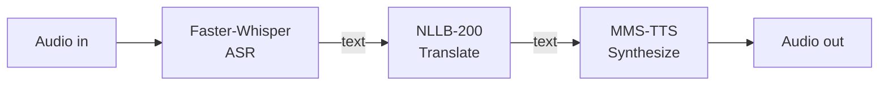

<div align="center">

#  Multilingual Speech-to-Speech Translation

###  Speak in one language → 🔊 Hear it in another


**Real-time • REST API • WebSocket • 200-language translation**

</div>

---

## What it does

|  Listen |  Translate |  Speak |
|:---:|:---:|:---:|
| Faster-Whisper | NLLB-200 | Meta MMS-TTS |
| Speech → text | Text → text | Text → speech |

-  **Live mic mode** with Silero VAD: just talk, pause, and hear the translation
-  **Hindi, Malayalam, English, French, Spanish** out of the box (easily extendable)
-  **Auto GPU/CPU**, with int8 quantization on CPU
-  **Hands-free stop**: say *"stop translation"* or press `q`

##  How it works



##  Quick Start

```bash
git clone https://github.com/<your-username>/<your-repo>.git
cd <your-repo>

python3 -m venv .venv
source .venv/bin/activate        # Windows: .venv\Scripts\Activate.ps1

pip install -r requirements.txt
python realtime_mic.py           #  start talking!
```

>  Model weights download automatically on first run. Using a GPU? Install the matching `torch` build from [pytorch.org](https://pytorch.org/get-started/locally/) first.

##  Ways to use it

| Mode | Command | What you get |
|---|---|---|
|  **Live mic** | `python realtime_mic.py` | Continuous real-time translation |
|  **Mic test** | `python test_mic.py` | Record 5s → `live_translated_output.wav` |
|  **File test** | `python test_local.py` | `harvard.wav` → `translated_output.wav` |
|  **API server** | `uvicorn server:app --port 8000` | REST + WebSocket on `localhost:8000` |

###  API

Docs live at **http://127.0.0.1:8000/docs**

| Method | Endpoint | Purpose |
|---|---|---|
| `GET` | `/health` | Health check |
| `POST` | `/translate-audio` | Upload audio → translated WAV |
| `WS` | `/ws/audio` | Stream audio in/out (English → Hindi) |

```bash
curl -X POST http://127.0.0.1:8000/translate-audio \
  -F "audio_file=@input.wav" \
  -F "target_lang=hin_Deva" \
  -F "tts_code=hin" \
  --output translated.wav
```

Transcript and translation come back URL-encoded in the `X-Transcript` and `X-Translation` headers.

##  Languages

| Language | Short | NLLB code | TTS code |
|---|:---:|:---:|:---:|
| 🇬🇧 English | `en` | `eng_Latn` | `eng` |
| 🇮🇳 Hindi | `hi` | `hin_Deva` | `hin` |
| 🇮🇳 Malayalam | `ml` | `mal_Mlym` | `mal` |
| 🇫🇷 French | `fr` | `fra_Latn` | `fra` |
| 🇪🇸 Spanish | `es` | `spa_Latn` | `spa` |

Want another language? Add it to `LANG_MAP` in `pipeline.py` and use its [NLLB](https://github.com/facebookresearch/flores/blob/main/flores200/README.md#languages-in-flores-200) and [MMS-TTS](https://huggingface.co/facebook/mms-tts) codes.

<details>
<summary> <b>Configuration</b></summary>

<br>

| Setting (`pipeline.py`) | Default | Notes |
|---|---|---|
| `WHISPER_SIZE` | `small` | `tiny` / `base` / `small` |
| `NLLB_MODEL` | `facebook/nllb-200-distilled-600M` | Translation model |
| `NUM_BEAMS` | `2` | Beam width |
| `QUANTIZE_NLLB_ON_CPU` | `True` | int8 on CPU |

For live mic mode, edit `SOURCE_LANG`, `TARGET_NLLB` and `TARGET_TTS` at the top of `realtime_mic.py`.

</details>

<details>
<summary> <b>Project structure</b></summary>

```text
├── pipeline.py        # ASR + translation + TTS
├── server.py          # FastAPI HTTP + WebSocket
├── realtime_mic.py    # Live mic with Silero VAD
├── test_local.py      # Translate a WAV file
├── test_mic.py        # Record & translate
├── requirements.txt
└── pyproject.toml     # Black / Ruff config
```

</details>

<details>
<summary> <b>Development</b></summary>

```bash
pip install black ruff
black --check .
ruff check .
python -m compileall -q .
```

</details>

##  Heads up

- Source language is **set manually**, not auto-detected.
- `/translate-audio` and `/ws/audio` assume **English** input.
- Development baseline, **not production-ready**. Add auth, upload limits, timeouts and rate limiting before exposing it publicly.

##  Built with

[Faster-Whisper](https://github.com/SYSTRAN/faster-whisper) · [NLLB-200](https://github.com/facebookresearch/fairseq/tree/nllb) · [Meta MMS](https://github.com/facebookresearch/fairseq/tree/main/examples/mms) · [Silero VAD](https://github.com/snakers4/silero-vad) · [FastAPI](https://fastapi.tiangolo.com/)

> Model weights have their own licenses (NLLB-200 and MMS are CC-BY-NC 4.0). Check before commercial use.

## 📄 License

Add a `LICENSE` file and name it here.

---

<div align="center">⭐ If this helped you, give it a star!</div>
